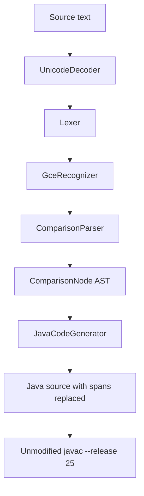
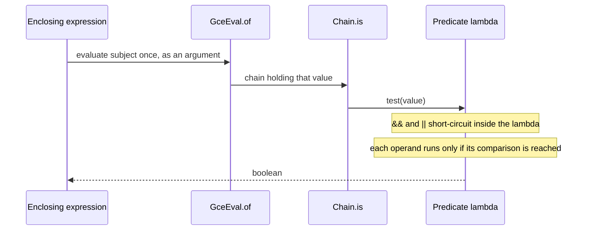

# GCE: Grouped Comparison Expressions — Design and Implementation of an Experimental Source-to-Source Extension for Java

**Document status.** The body of this paper is the historical 0.2.1 record. It is not the current design. Version 1.0.0 binds the subject with `var` (or `Object` for a null literal) inside a switch-expression block. Generated code does not call `GceEval`. `a + b (>= 0)` is a syntax error. A group is not a constant expression and is rejected in a `case` label or an annotation value. Record patterns and `_` are copied through. The measurements and the 36-test count below belong to 0.2.1. See `CHANGELOG.md` and `docs/GCE-LANGUAGE-SPECIFICATION.md` for 1.0.0.

This paper describes the GCE compiler prototype at version 0.2.1. The public repository is <https://github.com/issa-khodadadi/Grouped-Comparison-Expressions-GCE-Java>. The sources there are under the Apache License, Version 2.0; the text is the `LICENSE` file at the repository root. This paper is a technical report of that prototype. It is not a change to *The Java Language Specification* [1], and `javac` does not recognize GCE syntax.

**Keywords.** Source-to-source translation, syntactic sugar, Java SE 25, evaluation order, short-circuit evaluation, overload resolution.

## 1. Abstract

Grouped Comparison Expressions (GCE) let a Java programmer write one subject and several relational tests against it, as in `age (>= 18 && <= 65)`. The subject is evaluated once, only if the surrounding expression reaches the group, and `&&` and `||` keep the short-circuit rules of Java [1, §§15.23–15.24].

Version 0.2.1 is a source-to-source preprocessor. A lexer that respects strings, text blocks, character literals, and comments finds a postfix subject immediately before a comparison group. A recursive-descent parser builds a small AST. The generator replaces only that span with a call to `dev.gce.runtime.GceEval.of(subject).is(temp -> predicate)`. Unmodified `javac`, invoked with `--release 25`, type-checks and compiles the result. The translator does not patch the JDK, does not register a compiler plugin, and does not emit bytecode itself.

The subject is an argument of `of`, so it is evaluated in the enclosing method. A local used only as the subject may be reassigned, and a checked exception thrown by the subject can propagate. The predicate remains a lambda. A local named by an operand must still be effectively final [1, §4.12.4, §15.27.2], and a checked exception thrown by an operand is still illegal [1, §11.2]. Those two restrictions are tested, not hidden.

The same 36 JUnit 5 tests — 6 lexical, 14 translator, and 16 compile-and-run — were run twice, and the two runs are not the same environment. A local `mvn clean verify` on 22 November 2026, with the compiler release set to 25, reported 0 failures, 0 errors, and 0 skipped. Separately, GitHub Actions workflow `verify` succeeded on commit `58be4f8` with Eclipse Temurin JDK 25 and `bash mvnw -B verify`, again with 36 tests, 0 failures, 0 errors, and `BUILD SUCCESS`. This paper does not report a performance result for the 0.2.1 lowering. GCE is an experiment over a documented subset of Java expressions. It is not a claim of Java compatibility.

## 2. Introduction and Motivation

Java requires the subject of each relational test to be written out:

```java
order.getCustomer().getAddress().getHouseNumber() != null
    && order.getCustomer().getAddress().getHouseNumber() >= 0
```

If the subject has a side effect, textual repetition changes the program. If it does not, the repetition is still a maintenance hazard: one of the copies can drift. Binding the value to a local variable fixes the evaluation count, but a declaration is not an expression. Hoisting that declaration above a surrounding `&&` or `||` evaluates the subject even when the group is skipped [1, §15.7, §§15.23–15.24].

GCE is a small syntactic abbreviation for the case the programmer already means: one value, several comparisons, Java's own boolean connectives. The form is:

```java
person.getAddress().getHouseNumber() (!= null && >= 0)
```

The same source file may still contain ordinary Java. `(salary > 5000)` is not a group, and `age()` remains a method call.

This kind of abbreviation is syntactic sugar in the sense surveyed by van Deursen, Klint, and Visser [6] and by Fowler [7]: the host language stays in place, and a translation produces a program in that host language. SugarJ showed that Java can be extended with composable syntactic sugar inside the language [4]. JastAdd showed that an extensible Java compiler can add constructs by extending name and type analysis [5]. GCE takes neither of those routes. The input is not legal Java, so a Java parser, including `javac`'s parser, rejects it before any visitor runs. The prototype therefore translates first and then hands ordinary Java to an unmodified compiler. That boundary is deliberate. Extending `javac` would be a different project, and this repository does not do it.

The rest of the paper states the problem, the syntax that version 0.2.1 accepts, the compiler that implements it, the semantic obligations of the translation, the tests that were actually run, and the restrictions that remain.

## 3. Problem Statement

A correct translation of a grouped comparison has to satisfy all of the following at once.

1. **Expression position.** The group may appear wherever a Java expression may appear, including the condition of `if`, the operand of `&&`, and an argument of a call. Java has no statement-expression that can declare a temporary and yield a boolean [1].
2. **Exactly one subject evaluation, and only when the group is evaluated.** `false && next() (>= 0)` must not call `next`. Expanding the subject text onto every comparison would call it once per comparison.
3. **Short-circuit inside the group.** The right operand of `&&` or `||` runs only when the left operand does not decide the result [1, §§15.23–15.24]. An operand runs only when its comparison is reached, and it runs after the subject.
4. **Java equality.** `==` and `!=` on references compare identity. A primitive compared with a wrapper unboxes the wrapper. Two `Integer` objects that contain 1000 are not required to be the same object [1, §5.1.7, §15.21]. Boxing the subject and then using reference equality would change that meaning. Bloch's warning about boxed primitives is the same distinction [8].
5. **No new capture and no new checked-exception barrier on the subject.** A local that the subject names may be assigned more than once. Lambda bodies may mention a local only when it is effectively final [10]. A subject that throws a checked exception must still compile in a method that declares or handles that exception [1, §11.2].
6. **Ordinary Java stays ordinary Java.** Strings, text blocks, character literals, and comments that happen to contain `(>=` must be copied through. So must `age >= 18`.
7. **Failure must be a diagnostic.** A construct the grammar does not define must raise `GceSyntaxException`. The translator must not emit Java that is malformed for a reason the preprocessor already understood.

Version 0.1 met the surface syntax with a regular expression and a helper, `Gce.test(Supplier, Predicate)`, that boxes its subject. Version 0.2 replaced that scan with a lexer and an AST, and evaluated the subject in a `Supplier` whose body used `var`. The supplier preserved primitive types, but the lambda captured every local the subject named, and a checked exception could not leave it. Version 0.2.1 is the maintenance release that removes that capture for the subject, rewrites groups nested inside a subject, rejects several unsupported forms explicitly, and bounds parser recursion. It does not add operators. `instanceof` as a group operator remains a proposed feature and is rejected.

## 4. GCE Syntax and Examples

A group is a postfix subject followed by parentheses whose contents are comparison operators combined with `&&`, `||`, and nested parentheses. A `(` starts a group only when, after any further opening parentheses, the next token is `==`, `!=`, `<`, `<=`, `>`, or `>=`. Otherwise the parenthesis keeps its Java meaning.

```java
age (>= 18)      // grouped comparison
age()            // method invocation
(salary > 5000)  // ordinary Java comparison
```

The examples below are accepted by `GceTranspiler` in version 0.2.1. Each is paired with the ordinary Java the tests use as the semantic reading. The Java column is the single-evaluation form, not a textual copy of the subject onto every operator.

| GCE | Ordinary Java reading |
| --- | --- |
| `age (>= 18 && <= 65)` | `int v = age; v >= 18 && v <= 65` |
| `score (>= 90 \|\| (>= 70 && < 80))` | `v >= 90 \|\| (v >= 70 && v < 80)` |
| `five ((>= 0 \|\| >= 100) && >= 6)` | `(v >= 0 \|\| v >= 100) && v >= 6` |
| `person.getAddress().getHouseNumber() (!= null && >= 0)` | one call, then `!= null` and `>= 0` |
| `(low + high) (>= 5 && <= 5)` | the sum is the subject |
| `false && next() (>= 0)` | `next` is not called |

Two forms look similar and mean something else. They are specified this way so the grammar stays local.

- `a + b (>= 0)` has subject `b`. The sum is written `(a + b) (>= 0)`. The recognizer consumes a postfix expression, not a binary expression.
- `age (>= 18 < 65)` is one comparison. Its operand is the Java expression `18 < 65`. Juxtaposition does not invent a range. A range is `age (>= 18 && <= 65)`.

Operands are parenthesized in the output, because Java would otherwise reassociate them. `limit (>= a ? b : c)` must mean `limit >= (a ? b : c)`. Written without those parentheses, `limit >= a ? b : c` means `(limit >= a) ? b : c` [1, §15.25].

The following are copied unchanged when they are not themselves the subject or operand of a group, including when they appear in the argument list of a call that is a subject:

```java
int i = 0;
++i;
i++;
int n = (int) raw;
holder.new Inner();
id(++i) (>= 2)
```

The same tokens are syntax errors when they *are* the subject or the operand: `++f (>= 0)`, `n (>= f++)`, `(int) x (>= 0)`, and `holder.new Inner() (>= 0)`.

## 5. Language Design and Grammar

The grammar implemented by version 0.2.1 is the following. It is the grammar in `docs/GCE-LANGUAGE-SPECIFICATION.md`, and it matches `ComparisonParser` and `GceRecognizer`.

```ebnf
GroupedComparison ::= PostfixSubject ComparisonGroup

ComparisonGroup    ::= "(" ComparisonOr ")"
ComparisonOr       ::= ComparisonAnd { "||" ComparisonAnd }
ComparisonAnd      ::= ComparisonUnary { "&&" ComparisonUnary }
ComparisonUnary    ::= "(" ComparisonOr ")"
                     | ComparisonOperator Operand
ComparisonOperator ::= "==" | "!=" | "<" | "<=" | ">" | ">="

PostfixSubject ::= Primary { Suffix }
Primary        ::= Literal | Identifier | "this" | "super"
                 | "new" Creator | "(" BalancedTokens ")"
Suffix         ::= "." Identifier [TypeArguments] [Arguments]
                 | "." TypeArguments Identifier [Arguments]
                 | "[" BalancedTokens "]"
                 | Arguments
```

`Arguments` stops when the parenthesis is itself a comparison group. That is how `age() (>= 18)` is a call followed by a group, rather than a call whose argument list swallows the group.

Inside a group, precedence and associativity follow Java: parentheses, then a comparison term, then `&&` (left-associative), then `||` (left-associative). The AST records that structure. `a (>= 1 || >= 2 && >= 3)` is an `OrCondition` whose right child is an `AndCondition`. The unit test locks the generated text:

```java
(dev.gce.runtime.GceEval.of((a)).is($gce$0 ->
    (($gce$0 >= (1)) || (($gce$0 >= (2)) && ($gce$0 >= (3))))))
```

At parenthesis depth zero inside an operand, `&&` and `||` end the operand and belong to the group. Inside parentheses they are ordinary Java operators, so an operand may contain `flag && other`. The then-branch of `?:` is parsed with those connectives enabled, so `cond ? a && b : c` can be one operand. The else-branch still ends at a depth-zero `&&` or `||`.

### 5.1 What the operand parser accepts

An operand may be a literal, a name, a field, a call, an array access, a unary `+`, `-`, `!`, or `~`, the multiplicative and additive operators, shifts, relational and equality operators, `instanceof` used as a Java operator inside the operand, the bitwise operators, `?:`, `new` (including an anonymous class body or an array initializer scanned as a balanced brace span), and a parenthesized expression that may itself contain a group.

The parser rejects, with `GceSyntaxException`, an operand that is an assignment, a lambda, a method reference, a `switch` expression, a cast, a prefix or postfix increment or decrement, a qualified instance creation (`holder.new Inner()`), or a pattern variable after `instanceof`.

### 5.2 Recognition without a symbol table

Casts are rejected by a lexical pattern, not by type checking. `(int) x` is a cast because `int` is a primitive and a cast operand follows the parenthesis. A reference type followed by `+` or `-` is not treated as a cast operand, so `(a) - b` and `(low + high)` remain parenthesized expressions. `(age) (>= 0)` is a parenthesized subject: the group is not consumed as the cast operand. This rule is intentionally incomplete as a Java cast grammar. Its job is to refuse the forms the translator would otherwise mis-emit, and to leave ambiguous parentheses alone.

### 5.3 Proposed syntax, not accepted

```ebnf
ComparisonOperator ::= ... | "instanceof"    (* proposed for 0.3, rejected in 0.2.1 *)
```

`obj (instanceof String)` matches the shape of a group and is rejected. The diagnostic says that GCE `instanceof` is not supported in version 0.2 and is planned for version 0.3. Pattern variables, `switch` expressions as operands, and subjects that include binary operators to the left of the postfix expression are also future work. Section 13 lists them as proposals. Version 0.2.1 does not implement them.

## 6. Compiler Architecture

`GceTranspiler.transpile` is the public entry point. `Main` reads a file or prints a demonstration. The compiler is organized as a pipeline in front of unmodified `javac`.



Packages in the implementation:

| Package | Role in 0.2.1 |
| --- | --- |
| `dev.gce.compiler` | `GceTranspiler`, `GceSyntaxException`, `SourceLocations`, `GceLimits` |
| `dev.gce.compiler.lexer` | Unicode escapes, tokens, keywords |
| `dev.gce.compiler.parser` | Group grammar, subject scan, bracket matching |
| `dev.gce.compiler.ast` | Sealed `ComparisonNode` |
| `dev.gce.compiler.codegen` | Rendering of `GceEval.of(...).is(...)` |
| `dev.gce.runtime` | `GceEval`, called by generated code. `Gce.test` remains for direct calls and is not emitted |

There is no third-party compile dependency. The build is Apache Maven [12]. The compiler plugin is 3.13.0 with `<release>25</release>`. Tests use JUnit Jupiter 5.11.4 [11]. The project coordinates are `dev.gce:gce-compiler:0.2.1`.

The decision not to reuse a Java parser follows from the input language. JavaParser, Eclipse JDT, and `javac` all require a Java compilation unit. GCE source is not one until after translation. A full Java grammar is also unnecessary for the characters the translator copies through. What the lexer must get right are the token boundaries that would otherwise hide or invent a group: strings, text blocks, comments, numeric literals, and `>>` inside type arguments.

Generated code depends on `GceEval`. Compiling or running a translation therefore requires this jar on the classpath. That is a change from the 0.2 supplier lowering, which needed no project class at run time.

## 7. Lexer, Parser, AST, and Code Generation

### 7.1 Lexer

`UnicodeDecoder` applies the Unicode escapes of JLS §3.3 in one pass and records a map back to the original offsets [1, §3.3]. The lexer then produces tokens. Comments and whitespace are not tokens. Strings, character literals, and text blocks are single tokens, so a group spelled inside them is never rewritten. Text blocks require a line terminator after the opening `"""`, as in Java [1, §3.10.6].

Keywords follow the language, including `_`. Contextual keywords such as `var`, `yield`, `record`, `sealed`, `permits`, and `when` remain identifiers, so they can still be names in a subject or operand. Numeric literals follow the usual shape, including hex, binary, underscores, and suffixes. A suffix is taken only when the next character cannot continue an identifier, so `f` in a name is not a `float` suffix. An integer literal that is octal and contains the digit 8 or 9 is an error. Identifiers already present in the compilation unit are collected so that generated names do not collide with them.

Operators use longest match. `>>` and `>>>` close two or three type-argument brackets only when the whole token belongs to the type arguments. A token that would have to be split between a type argument and an operator is rejected. Splitting those tokens is listed as later work.

### 7.2 Subject recognition

`GceRecognizer` walks tokens from left to right. At a token that can start a postfix expression it scans a subject: a literal, a name, `this`, `super`, `new`, or a balanced `(...)`, followed by field access, calls, and `[...]`. Method arguments and array indexes are consumed by matching `()`, `[]`, and `{}`. Their interior is not a second Java parser.

When the tokens after that postfix form a comparison group, the recognizer does not copy the subject text raw. It first calls the same rewrite function on the subject slice, then chooses a fresh parameter name, then generates the outer group. Inner groups therefore become `GceEval` calls before they are placed in the outer `of(...)`. The reserved-name set is shared, so inner and outer parameters do not collide. This second pass is what translates all three of the following:

```java
id(age() (>= 18 && <= 65)) (>= 1)
(age() (>= 18 && <= 65) ? 1 : 0) (>= 1)
values[age() (>= 18) ? 0 : 0] (>= 1)
```

A group that is not nested inside a larger subject is still found by the left-to-right walk. `a (>= 1) && b (>= 2)` becomes two independent translations.

If the subject scan commits a whole postfix span, a later walk of the original token stream will not visit the tokens inside it again. The subject-slice rewrite is the mechanism that recovers groups in that interior. Without it, version 0.2 left the raw text `(>=` inside the subject, and `javac` rejected the output.

### 7.3 Parser and AST

`ComparisonParser` is a recursive-descent parser [3]. `parseOr` builds `OrCondition` nodes, `parseAnd` builds `AndCondition` nodes, a parenthesized group term becomes `ParenthesizedCondition`, and a comparison operator plus an operand span becomes `RelationalCondition`. `ComparisonNode` is a sealed interface permitting exactly those four records. Code generation pattern-matches the tree. Precedence is a property of the tree and of the parentheses the generator prints, not of string concatenation during parsing.

Before each recursive step — a group, a parenthesized term, a unary operator, a parenthesized primary, and each branch of `?:` — `enter` checks the depth. `GceLimits.MAX_NESTING` is 64. If `depth >= 64`, the parser throws `GceSyntaxException` with the detail `nesting is too deep` and does not recurse. `GceTranspiler.rewrite` applies the same limit to nested translation of subject and operand slices, throwing when `depth > 64`. Excessive nesting therefore becomes a syntax error rather than `StackOverflowError`.

Operand spans record character offsets. When a span contains `(`, the transpiler translates that slice with positions shifted back onto the original file, so a diagnostic inside a nested operand reports the original line and column.

`GceSyntaxException` extends `IllegalArgumentException`. It carries a detail string, a 0-based offset, and 1-based line and column in the original source. `transpile` does not return a partial rewrite after a syntax error.

### 7.4 Code generation

`JavaCodeGenerator.generate` renders one group as:

```java
(dev.gce.runtime.GceEval.of((subject)).is(temp -> predicate))
```

`temp` is `$gce$` plus a number, skipping any identifier already reserved. The predicate is fully parenthesized. A relational leaf is `(temp op (operand))`. The operand text is itself rewritten, so a group nested in an operand becomes an inner `of`.

`GceEval` is a final class with a private constructor. `of` has five overloads:

```java
public static BooleanChain of(boolean subject)
public static IntChain of(int subject)
public static LongChain of(long subject)
public static DoubleChain of(double subject)
public static <T> RefChain<T> of(T subject)
```

Each chain stores the value and exposes `is`. `IntChain.is` takes `IntPredicate`, `LongChain.is` takes `LongPredicate`, `DoubleChain.is` takes `DoublePredicate`, `RefChain.is` takes `Predicate<T>`, and `BooleanChain.is` takes a small `BooleanPredicate` defined in `GceEval` because `java.util.function.Predicate` is not a primitive specialization for `boolean`.

The lambda is the argument of `is`, not of `of`. Overload resolution therefore sees only the subject [1, §15.12.2]. A primitive subject selects a primitive chain in the first phase of overload resolution, where boxing is not considered. A reference, including a boxed primitive and a `null` literal, selects `RefChain`. That split is what keeps `int == Integer` numeric and `Integer == Integer` an identity comparison.

`char`, `byte`, and `short` subjects widen to `int`. `float` subjects widen to `double` under the widening primitive conversion [1, §5.1.2]. Conversion from binary32 to binary64 preserves every finite value [2]. A `long` has its own chain so that a value near the 53-bit boundary of binary64 is not rounded. The end-to-end suite executes a `char` subject and a `long` subject at that boundary. It does not contain a separate `byte` or `short` fixture.

`dev.gce.runtime.Gce.test(Supplier<T>, Predicate<T>)` is still in the jar. Its Javadoc states that the translator does not emit it, that `T` boxes a primitive, and that `==` after that boxing is a reference comparison. The unit tests that call it are named `helperEvaluatesSubjectOnce` and `helperPreservesShortCircuit`. They document the helper. They do not establish the meaning of generated code.

## 8. Semantic Preservation and Evaluation Order

For a group that the surrounding expression actually evaluates, the lowering does four things, in order.



Java evaluates a method argument before the call, and it does not evaluate the right operand of `&&` or `||` when the left operand decides the result [1, §15.7, §§15.23–15.24]. `false && GceEval.of(subject).is(...)` therefore never evaluates `subject`. That is the reason a block-local `var` above the `if` was rejected: the declaration would run even when the group is skipped. It is also the reason the subject is not inside the predicate lambda. A lambda would delay the subject until `is` runs, which is late enough for short-circuit, but it would capture the locals the subject names [1, §15.27.2] and it could not throw a checked exception [1, §11.2].

The predicate still runs once, inside `is`. Inner `&&` and `||` are ordinary Java operators in the lambda body, so their short-circuit behavior is Java's. Operands are subexpressions of that body. An operand that itself contains a group is translated first, and that inner subject follows the same rule.

Left-to-right order among side effects is the order of the generated expression: the subject argument, then the comparisons from left to right, each operand only if control reaches it. The end-to-end behavior test prints the names of `side` calls. The asserted transcript begins the relevant region with `ABCtrue`, then `false` for a group skipped by `false &&` (the name `Z` is absent), then `Dtrue` (`E` is absent because `>= 0` is already true), then `Ffalse` (`G` is absent because the first comparison is false). Those strings are the assertion in `translatedProgramMatchesSingleEvaluationJava`, and that test passed in the 36-test run.

Null handling follows the chain that overload resolution selected. `nil (== null)` on a null `Integer` is reference equality and is true. `nil (>= 0)` unboxes and throws `NullPointerException`, which the test reports as the line `npe`. `nil (!= null && >= 0)` does not unbox when the null test is false, because the `&&` inside the predicate skips the relational operand. `int (== null)` is still illegal after translation: the primitive overload does not make `null` a legal operand of `==` on `int`. The test `primitiveComparedWithNullStaysIllegal` asserts that `javac` rejects it.

Identity is checked with values outside the mandatory boxing cache. Two `Integer` objects holding 1000 compare false under `==`. The same `Integer` compared with the `int` 1000 compares true, in both directions, because the primitive overload or the unboxing comparison applies [1, §5.1.7, §15.21]. The asserted lines are `false`, then `true`, `true`, `true`. A `String` and an enum constant are compared by identity as well.

One oracle line is weaker than the others. The handwritten twin of `new ArrayList<...>().size() (>= 0 && <= 0)` constructs the list twice in source. Both sizes are 0, so that line cannot catch a double evaluation. The counters in `next`, `side`, and the later `age()` tests are the evidence for single evaluation.

### 8.1 What the lambda still captures

The subject argument and the predicate lambda are different contexts.

| Kind of expression | Where it is compiled | Reassigned local | Checked exception |
| --- | --- | --- | --- |
| Subject | Argument of `GceEval.of`, in the enclosing method | Allowed. `reassignedLocalMatchesJava`, `forLoopIndexMatchesJava`, and `arrayIndexInLoopMatchesJava` compile and match their twins | Propagates. `checkedExceptionFromSubjectPropagates` compiles and prints the same result as a direct call |
| Operand | Body of the lambda passed to `is` | Rejected by `javac` if the local is not effectively final. `operandThatUsesAReassignedLocalIsStillRejectedByJavac` asserts compilation failure | Rejected by `javac`. `checkedExceptionInOperandStaysIllegal` asserts compilation failure |

Sneaky-throw is not used. It would hide the checked exception from the method's `throws` clause. The operand restriction is a property of the current lowering, not of the evaluation rules in section 6 of the language specification. A later lowering could move operands out of the lambda. Version 0.2.1 does not.

## 9. Implementation Details (GCE 0.2.1, Java 25)

Version 0.2.1, dated 22 November 2026 in `CHANGELOG.md`, is a semantic-correctness release. It adds no group operator.

The concrete lowering replaced the 0.2 shape. Version 0.2 emitted a `Supplier<Boolean>` whose body was `var $gce$N = (subject); return (predicate);`. The `var` preserved the subject type, which is why boxing regressions of the 0.1 helper were already gone, but the supplier captured locals and blocked checked exceptions. Version 0.2.1 does not emit `Supplier`, `Gce.test`, or the older fixed name `__gce_value`. The end-to-end behavior test asserts those absences and asserts that `GceEval.of` is present.

`GceEval.of` returns a chain that holds the subject value, and `is` receives a lambda. For each group that is evaluated, the generated source therefore constructs one chain instance and one lambda expression. That describes the source, not a measured heap cost. A just-in-time compiler may scalar-replace those objects or otherwise avoid allocating them. This paper does not measure allocation or execution time. `GceBenchmark` is a manual `main`, excluded from the JUnit suite. Figures previously recorded for the 0.2 supplier lowering describe a different translation and are not results for `GceEval`.

Unsupported subjects are diagnosed before a group is emitted. A prefix `++` or `--` whose postfix continuation is followed by a group produces a detail containing `prefix increment` or `prefix decrement` and `in a GCE subject`. A postfix `++` or `--` between the subject and the group produces the postfix diagnostic. A cast pattern followed by a group produces `casts are not supported in a GCE subject`. A qualified `new` in the subject produces `qualified instance creation is not supported in a GCE subject`. The operand parser has the corresponding messages with `in a GCE operand`. Ordinary occurrences of the same tokens, including `id(++i)` and `id(box.new Inner().v())` used as subjects of an outer group, are copied through. `ordinaryJavaInsideASubjectArgumentIsKept` compiles both and matches a handwritten twin.

The nesting limit is shared. A file with more than 64 nested groups, or more than 64 nested parentheses in the recursive forms the parser enters, throws `GceSyntaxException`. The translator test builds a nest of `GceLimits.MAX_NESTING + 5` and expects that exception. The parser checks the limit before the recursive call, which is the property that keeps a hostile file off the Java stack.

Diagnostics and tools around the translator:

- `Main`, given two paths, writes UTF-8 and creates parent directories. A shell redirection that writes UTF-16 is outside the translator. The two-argument form exists so the output file is not produced that way.
- Positions survive nested rewrites through `GceSyntaxException.relocate`.
- The test compiler is `javax.tools.JavaCompiler` from `ToolProvider`, the public compiler API [9], with options `--release 25` and `--class-path` set to the running JVM's classpath so `GceEval` resolves. The test harness uses reflection only to invoke the compiled `main`. The translator does not.

The prototype is built and tested as Java 25 source. It does not use reflection, bytecode rewriting, or undocumented compiler APIs to implement the translation.

## 10. Experimental Evaluation and Test Results

The evaluation of version 0.2.1 is a functional test suite, not a performance study. No throughput, latency, allocation rate, or speedup is claimed for the `GceEval` lowering. The counts below come from two separate executions of that suite.

### 10.1 How the tests run

**Local run.** On 22 November 2026 the command `mvn clean verify` was run in the project tree. Maven's compiler plugin used release 25. Surefire reported:

| Suite | Tests | Role |
| --- | ---: | --- |
| `LexerTest` | 6 | Comments, strings, text blocks, numeric suffixes, octal diagnostics, Unicode escapes, character escapes |
| `GceTranspilerTest` | 14 | Recognition, precedence, name collision, diagnostics, rejected forms, nesting, and the helper's own contract |
| `GceEndToEndTest` | 16 | Translate, compile with `javac --release 25`, execute, compare |
| **Total** | **36** | **0 failures, 0 errors, 0 skipped. `BUILD SUCCESS`** |

The same command packaged `target/gce-compiler-0.2.1.jar`. The saved log does not print a JDK or Maven version line. On the workstation where that command is available, `java -version` reports Oracle JDK 25.0.2 and `mvn -version` reports Apache Maven 3.8.3. This working tree is not a git checkout, so that local run has no recorded commit identifier.

**GitHub Actions run.** This is a different execution. Workflow `verify`, defined in `.github/workflows/verify.yml`, runs on `ubuntu-latest`. It checks out the repository, selects Eclipse Temurin JDK 25 with `actions/setup-java@v4`, and runs `bash mvnw -B verify`. At commit `58be4f8` the wrapper's `distributionUrl` is Maven 3.9.9. The latest successful run of that workflow is commit `58be4f8767dbcaede81c1d04aa75474b3478eaa5`. The Verify step completed with success. The recorded Surefire result of that run is 36 tests, 0 failures, 0 errors, and `BUILD SUCCESS`. The workflow page is <https://github.com/issa-khodadadi/Grouped-Comparison-Expressions-GCE-Java/actions/workflows/verify.yml>. The run itself is <https://github.com/issa-khodadadi/Grouped-Comparison-Expressions-GCE-Java/actions/runs/45016025250>.

`GceEndToEndTest` normalizes `\r\n` to `\n` before comparing stdout, because `println` on Windows writes CRLF. Where a program is expected to be illegal, `JavaRunner.assertDoesNotCompile` requires the JDK compiler to reject the translation. Where it is expected to be legal, the test compiles a GCE class and a handwritten Java class and requires identical stdout. The Java class is the single-evaluation reading from section 8, written out by hand.

### 10.2 Compile-and-run cases

`translatedProgramMatchesSingleEvaluationJava` is the largest oracle. After translation it asserts that the string `"age (>= 18)"`, the comment `// age (>= 99)`, and the comment `/* salary (>= 1) */` are still present, then runs the program. The expected transcript, which the passing test compares exactly, is:

```text
accepted
true
1
false
1
true
true
true
true
false
true
true
true
true
npe
true
true
true
false
true
false
true
false
true
true
true
true
true
false
ABCtrue
false
Dtrue
Ffalse
true
true
true
true
true
false
true
age (>= 18)
done
```

The same transcript is required of the handwritten class `JavaBehavior`. The lines cover acceptance of a mixed GCE and ordinary comparison, one call to `next` when the second bound is skipped, string and enum identity, boxed versus primitive equality at 1000, a null unbox that throws, precedence with and without parentheses, a null house number that must not be unboxed, `NaN`, and the side-effect order described in section 8.

The other end-to-end methods, all of which passed in that local run, are:

| Test | What the passing assertion establishes |
| --- | --- |
| `textBlockSurvivesAndRealGroupStillRuns` | A text block still contains the characters `age (>= 18)`, and a real group in the same method prints `true` |
| `primitiveComparedWithNullStaysIllegal` | `x (== null)` for an `int` parameter is rejected by `javac` |
| `nestedGroupInsideAnOperandKeepsBothSubjectsSingle` | `flag (== (next() (>= 1 && <= 1)))` prints `true` and `1` |
| `reassignedLocalMatchesJava` | `age` is 25, then assigned 10. Both groups match the twin |
| `forLoopIndexMatchesJava` | `for (int i = 0; i < 10; i++)` uses `i` as the subject. The twin counts the same iterations |
| `arrayIndexInLoopMatchesJava` | `values[i]` is the subject while `i` changes. The twin appends the same indexes |
| `checkedExceptionFromSubjectPropagates` | `read() throws Exception` is the subject. Both programs compile and print the same text |
| `checkedExceptionInOperandStaysIllegal` | `n (>= read())` with `read() throws Exception` does not compile |
| `operandThatUsesAReassignedLocalIsStillRejectedByJavac` | `i (>= 0 && <= j)` followed by `j = 2` does not compile |
| `nullLiteralSubjectMatchesJava` | `null (== null)` and a null `String` compared with `== null` match the twin |
| `longNearTheDoubleBoundaryStaysIntegral` | `9007199254740993L (== big)` and `(== big + 1)` match a `long` twin, so the subject was not rounded through `double` |
| `groupInsideMethodArgumentOfASubjectRunsOnce` | `age()` runs once inside `id(...)`, and `false &&` leaves the call counter unchanged |
| `groupInsideParenthesizedSubjectRunsOnce` | A group inside `( ... ? 1 : 0)` runs its subject once |
| `groupInsideArrayIndexOfASubjectRunsOnce` | A group inside an index expression runs its subject once |
| `ordinaryJavaInsideASubjectArgumentIsKept` | `id(++i)` and `id(box.new Inner().v())` compile and match the twin |

`9007199254740993L` is \(2^{53}+1\). Binary64 cannot distinguish that integer from its successor. Agreement with the `long` twin is evidence that this subject used `LongChain`. It is one value, not a sweep of the `long` domain.

### 10.3 What the suite does not show

The 36 tests do not measure translation time, run time, or heap allocation. They do not cover every Java statement form, and they do not prove that an untested combination of generics, shifts, and groups will be copied correctly. `byte` and `short` subjects are accepted by overload resolution and are not given their own executed fixture. A group inside a subject is tested for a call argument, a parenthesized expression, and an array index, which are the three cases the recognizer rewrites by the subject-slice pass. The suite is evidence about those programs. It is not a universal claim about Java.

### 10.4 Reproducing the build

The repository is <https://github.com/issa-khodadadi/Grouped-Comparison-Expressions-GCE-Java>. The commit whose GitHub Actions run is cited above is `58be4f8767dbcaede81c1d04aa75474b3478eaa5`.

| Environment | JDK | Maven | Command |
| --- | --- | --- | --- |
| Local workstation, 22 November 2026 | Oracle JDK 25.0.2, observed with `java -version` on that workstation. The verify log itself does not print this string | Apache Maven 3.8.3, observed with `mvn -version`. Compiler release 25, set in `pom.xml` | `mvn clean verify` |
| GitHub Actions workflow `verify`, run on commit `58be4f8` | Eclipse Temurin JDK 25, selected by `actions/setup-java@v4` on `ubuntu-latest` | Maven 3.9.9, the wrapper distribution at that commit | `bash mvnw -B verify` |

Both commands execute the Maven `verify` lifecycle: compile, test, and package. They are not substitutes for each other. The local command uses the Maven installation on the path. The Actions command uses the wrapper.

## 11. Limitations and Known Issues

The limitations below are properties of version 0.2.1. They are also stated in the language specification and the roadmap. They are not defects discovered after the tests and then omitted.

1. **Operand capture.** A local variable named by an operand is captured by the predicate lambda and must be effectively final [1, §4.12.4, §15.27.2]. A local named only by the subject may be reassigned, including a `for` index. The failing case is tested.

2. **Checked exceptions in operands.** A checked exception from the subject propagates, because the subject is an argument in the enclosing method. A checked exception from an operand is a compile-time error in the lambda [1, §11.2]. The translator does not wrap, sneak, or erase it. The failing case is tested.

3. **Rejected forms, not implemented forms.** Casts, prefix and postfix `++` and `--`, and qualified instance creation are syntax errors in subject and operand position. Leaving them for `javac` to repair would mean emitting malformed Java. They remain legal in ordinary code and inside a subject call's argument list.

4. **Postfix subjects only.** `a + b (>= 0)` compares `b`. The language does not look left through `+`. Extending the subject would require a precedence walk so that `flag && a + b (>= 0)` does not absorb the `&&`. That walk is proposed, not implemented.

5. **`instanceof` groups.** The token is recognized and rejected. There is no type-test grammar and no scope rule for pattern variables.

6. **Nesting cap.** More than 64 nested groups, parentheses, unary operators, or conditional operators, in the forms that call `enter` or `rewrite`, is a syntax error.

7. **Comments inside a replaced span disappear.** The lexer does not keep trivia, and the generator prints a new expression. Comments, strings, and text blocks *outside* a replaced span are preserved. The behavior test checks a string and two comments that are not inside a group.

8. **No split of `>>` or `>>>`.** A shift token that would need to be divided between a type argument and an operator is unsupported.

9. **No separate type checker.** Ill-typed output is `javac`'s diagnostic. The translator's own errors are lexical and syntactic. `int == null` is an example of a type error that correctly survives translation.

10. **Classpath.** Generated source calls `dev.gce.runtime.GceEval`. The jar must be present at compile time and at run time.

11. **`Gce.test` still boxes.** Direct calls can change the meaning of `==`. Generated code does not call it. The class is retained and documented so that an old call site is not silently redefined.

12. **Not Java, and not a `javac` feature.** The preprocessor accepts a subset. A program outside that subset is either copied through for `javac` to accept or reject, or it is a `GceSyntaxException`. Nothing in this repository modifies the compiler or the language specification. There is no `javac` plugin and no change to the language specification.

The repository is licensed under the Apache License, Version 2.0. The terms are the `LICENSE` file, which is the standard Apache 2.0 text, including the copyright and patent grants, the redistribution conditions, and the warranty disclaimer. A copy at the cited commit is <https://github.com/issa-khodadadi/Grouped-Comparison-Expressions-GCE-Java/blob/58be4f8767dbcaede81c1d04aa75474b3478eaa5/LICENSE>.

Unicode escapes that encode a line terminator are a further diagnostic mismatch: `SourceLocations` counts line breaks in the raw file. That behavior is unchanged in 0.2.1 and is not covered by a claim of column-for-column agreement with `javac`.

## 12. Comparison with Conventional Java

GCE does not change the meaning of a Java program that contains no group. The interesting comparison is between a group and the Java a programmer would write by hand.

| Question | Conventional Java | GCE 0.2.1 |
| --- | --- | --- |
| How is the subject named? | Written at every comparison, or bound by a local declaration | Written once, as the postfix subject |
| When does the subject run? | At each textual occurrence, or at the declaration | Once, and only if the group is evaluated |
| What does `age (>= 18 && <= 65)` mean to `javac` if it is not translated? | A syntax error | The preprocessor must run first |
| What does `age >= 18 && age <= 65` mean? | Two evaluations of `age` | Unchanged. This is not a group |
| Precedence of `&&` and `\|\|` | `&&` tighter than `\|\|`, both left-associative [1] | The same, inside the group |
| `==` on two references | Identity [1, §15.21] | Identity, through `RefChain` |
| `==` between `int` and `Integer` | Unboxing | Unboxing, through the primitive chain or the operand |
| `Integer` 1000 `==` `Integer` 1000 | Not required to be true [1, §5.1.7] | The behavior test expects `false`, matching the twin |
| Checked exception in the subject | Propagates under the ordinary rules [1, §11.2] | Propagates |
| Checked exception in a comparison operand | Propagates | Rejected, because that operand is inside a lambda |
| Local reassigned and then used as the subject | Legal | Legal |
| Local reassigned and used as an operand | Legal | Rejected by `javac` |
| Cast, `++`, qualified `new` | Legal expressions | Legal outside a group subject or operand. Syntax errors inside them |
| Who type-checks? | `javac` | `javac`, after translation |
| What does the translation construct for the saved subject? | The programmer's local, or a repeated expression | A `GceEval` chain expression and a lambda each time the group is evaluated. That is source shape. A JIT may remove both, and no heap cost is claimed |

The last row describes generated source. It is not a measurement of allocation or of speed.

Conventional Java can express every program GCE translates. The abbreviation is justified only when the single-evaluation reading is the one the programmer wanted, and only inside the subset section 5 accepts. Repeating a subject is still the right Java when the two occurrences are meant to run twice.

## 13. Future Work

The items in this section are proposals recorded in `docs/ROADMAP.md`. Version 0.2.1 does not implement them, and the test suite does not treat them as done.

1. **`instanceof` groups.** `shape (instanceof Circle || instanceof Rectangle)` needs a type-test grammar. Pattern variables need a scope rule. Until that grammar exists, the operator remains a syntax error.

2. **Checked exceptions from operands.** A translation that is not a lambda, or a lambda that is allowed to throw, would have to preserve the enclosing method's `throws` clause. Sneaky-throw is explicitly rejected as a shortcut.

3. **Operand capture.** A temporary that is not a lambda parameter would allow an operand to name a local that is not effectively final. The subject already has that freedom. The operand does not.

4. **A measured cheaper lowering.** The 0.2.1 source constructs one chain instance and one lambda for each group that is evaluated. Whether those become heap allocations depends on the JIT, and that cost has not been measured. If a statement-position temporary or a bytecode lowering is attempted, the comparison belongs in a proper benchmark harness. The 0.2 supplier timings must not be reused as measurements of `GceEval`. This paper does not supply new timings.

5. **Subjects that are not postfix expressions.** `(a + b) (>= 0)` is implemented. `a + b (>= 0)` is not the sum. A leftward precedence walk is future work.

6. **Comments inside a group.** Keeping them requires the lexer to retain trivia and the generator to place it. Today those comments are inside the replaced span and disappear.

7. **A `javac` integration experiment.** The viable order is still rewrite, then compile. A `com.sun.source.util.Plugin` sees Java, not GCE, unless the rewrite has already happened. Exploring that boundary would still not mean that OpenJDK had accepted the feature.

Explicitly later, and not scheduled as part of 0.2.1: IDE highlighting, a source map, pattern matching and `switch` expressions as operands, splitting `>>` and `>>>`, and any text aimed at the Amber specification or the JLS. Non-goals remain a forked JDK, silent acceptance of undefined syntax, and treating `Gce.test` as the meaning of `==`.

## 14. Conclusion

GCE 0.2.1 is a preprocessor that rewrites a narrow, specified abbreviation into Java 25 and leaves everything else to `javac`. The abbreviation is real: one postfix subject, comparisons combined by `&&` and `||` with Java's precedence, one evaluation when the group runs, and no evaluation when a surrounding connective skips it. The implementation that meets those rules for the subject is `GceEval.of(subject).is(temp -> predicate)`, with overloads chosen so that primitive and reference equality stay apart.

The 36 tests that passed under the local `mvn clean verify`, and again under the GitHub Actions run on commit `58be4f8`, cover the lexical boundary, the generated shape, and a set of programs compiled and executed on JDK 25. They include the cases that version 0.2 got wrong or refused: a reassigned local, a `for` index, an array element, a checked exception from the subject, and a group nested inside a subject. They also lock the cases the new lowering still refuses: a checked exception in an operand, and an operand that names a local which is later assigned.

That is the honest scope of the prototype. The operand lambda is still a capture and a checked-exception barrier. Casts, increments, qualified instance creation, and `instanceof` groups are rejected or deferred. The subject stops at a postfix expression. Nesting above 64 is rejected. No performance result is offered. GCE is not part of Java, and this repository does not modify `javac`. The language specification, citing Hoare, treats untested features as something a production language does not absorb by default [1, 13]. Within the limits above, version 0.2.1 is a coherent experimental translator: the specification, the code, and the tests describe the same language.

## 15. References

[1] James Gosling, Bill Joy, Guy Steele, Gilad Bracha, Alex Buckley, Daniel Smith, and Gavin Bierman. *The Java Language Specification, Java SE 25 Edition*. Oracle, 29 July 2025. JSR 400. <https://docs.oracle.com/javase/specs/jls/se25/html/>

[2] IEEE. *IEEE Standard for Floating-Point Arithmetic*. IEEE Std 754-2019. Institute of Electrical and Electronics Engineers, 2019.

[3] Alfred V. Aho, Monica S. Lam, Ravi Sethi, and Jeffrey D. Ullman. *Compilers: Principles, Techniques, and Tools*. 2nd edition. Addison-Wesley, 2006.

[4] Sebastian Erdweg, Tillmann Rendel, Christian Kästner, and Klaus Ostermann. "SugarJ: Library-based Syntactic Language Extensibility." In *Proceedings of the 26th ACM SIGPLAN Conference on Object-Oriented Programming, Systems, Languages, and Applications (OOPSLA 2011)*, pages 391–406. ACM, 2011. <https://doi.org/10.1145/2048066.2048099>

[5] Torbjörn Ekman and Görel Hedin. "The JastAdd Extensible Java Compiler." *ACM SIGPLAN Notices*, 42(10):1–17, 2007. OOPSLA 2007. <https://doi.org/10.1145/1297105.1297029>

[6] Arie van Deursen, Paul Klint, and Joost Visser. "Domain-Specific Languages: An Annotated Bibliography." *ACM SIGPLAN Notices*, 35(6):26–36, June 2000. <https://doi.org/10.1145/352029.352035>

[7] Martin Fowler. *Domain-Specific Languages*. Addison-Wesley, 2010.

[8] Joshua Bloch. *Effective Java*. 3rd edition. Addison-Wesley, 2018. Item 61, "Prefer primitive types to boxed primitives."

[9] Java Community Process. *JSR 199: Java Compiler API*. <https://jcp.org/en/jsr/detail?id=199>

[10] Java Community Process. *JSR 335: Lambda Expressions for the Java Programming Language*. 2014. <https://jcp.org/en/jsr/detail?id=335>

[11] JUnit team. *JUnit 5 User Guide*. <https://junit.org/junit5/docs/current/user-guide/>

[12] Apache Software Foundation. *Apache Maven*. <https://maven.apache.org/>

[13] C. A. R. Hoare. *Hints on Programming Language Design*. Stanford Artificial Intelligence Laboratory Memo AIM-224, Technical Report STAN-CS-73-403, Stanford University, December 1973. The report is based on a keynote given in October 1973. The Java Language Specification cites the same design caution: a production language does not absorb an untested feature by default [1]. <http://i.stanford.edu/pub/cstr/reports/cs/tr/73/403/CS-TR-73-403.pdf>
